# AI Persona

**A real-time talking avatar that acts on your accounts, asks before it acts, and remembers you.**

AI Persona is a personal assistant with a face. You see an avatar, talk to it like a person, and it answers in a natural voice while its lips, eyes and head move with the speech. Behind the face is an agent that does real work on your own email, calendar, contacts and files, and that never changes anything without your "yes".

Team: Ahmed Hussain and Maria, Department of Artificial Intelligence, COMSATS University Islamabad, Lahore Campus.

- **Full proposal:** [PROPOSAL.md](PROPOSAL.md)
- **Website:** https://aipersona.ahmedhussain.tech

## What it does

| | |
|---|---|
| **A face that speaks** | An avatar generated from the assistant's own speech, at video rate on one GPU, made from a single photograph |
| **Acts on your accounts** | Gmail, Google Calendar, Contacts, Drive, to-do list, reminders, weather, web search, nearby places, your own documents |
| **Asks before it acts** | Every email, booking and deletion is shown on a card and waits for a yes; an unclear name is asked about, never guessed |
| **Works while you are away** | "If she hasn't replied by 5, send a follow-up; if she does, thank her", and it tells you what happened |
| **Remembers you** | Learns facts from conversation and keeps them in a graph you can see, correct and forget |
| **Fast** | The reply starts about 0.9 seconds after you stop speaking |

## Screenshots

**The assistant on the web**

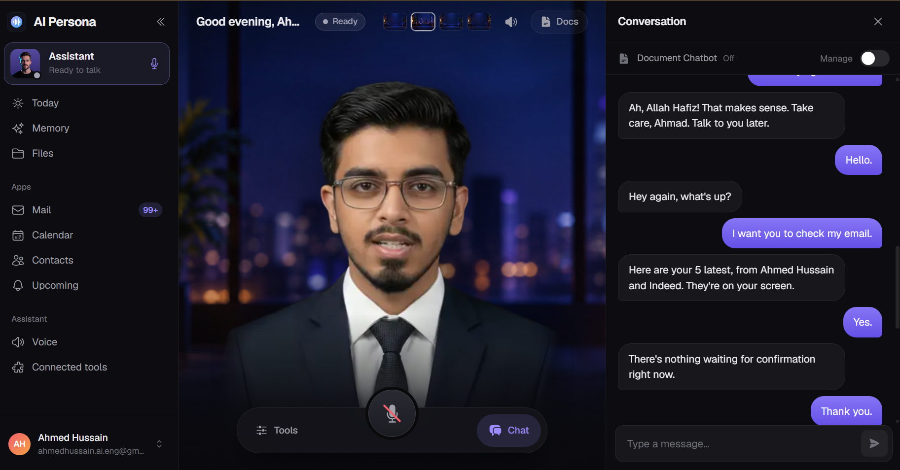

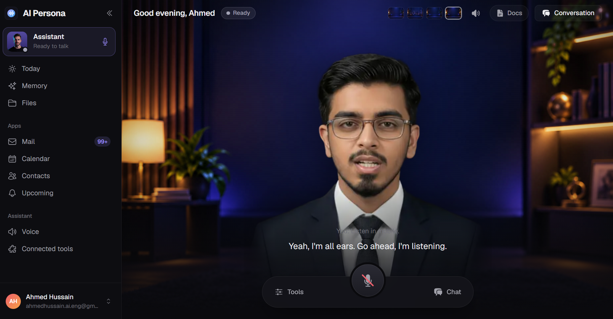

**The memory graph**

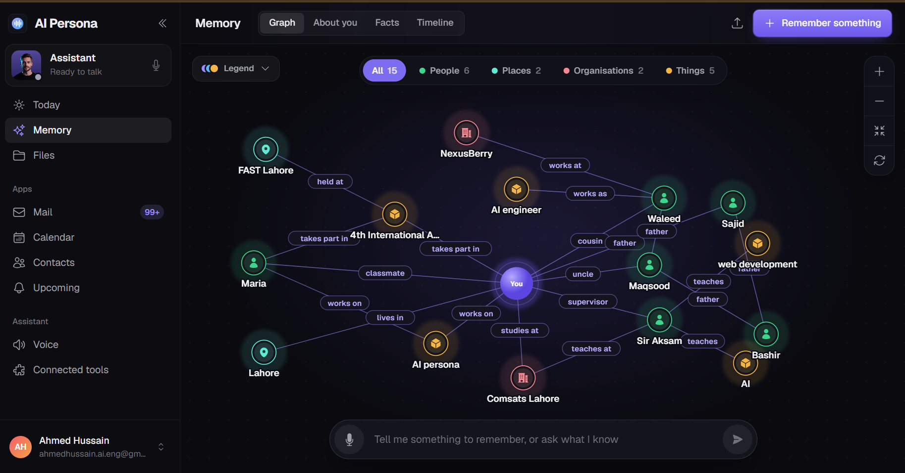

**The Today page**

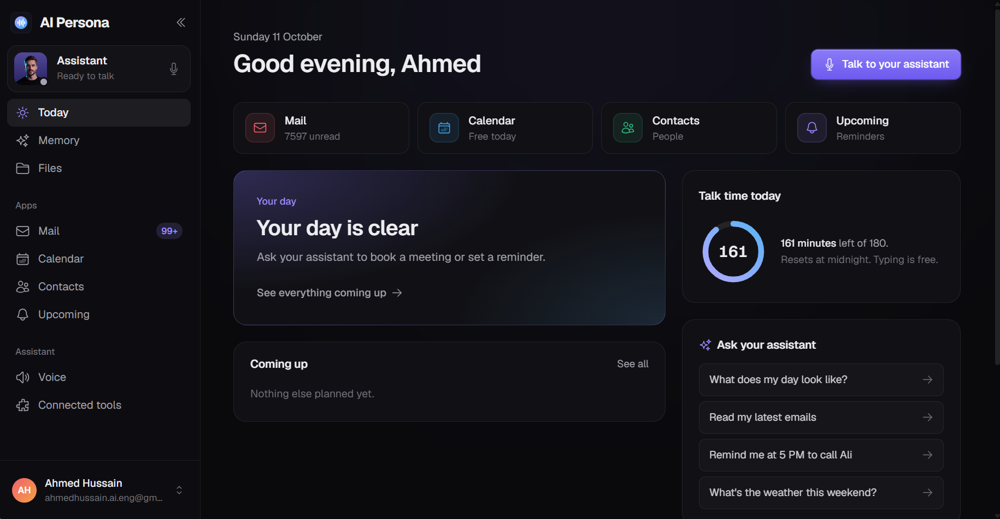

**The mobile app**

<table>
<tr>
<td align="center">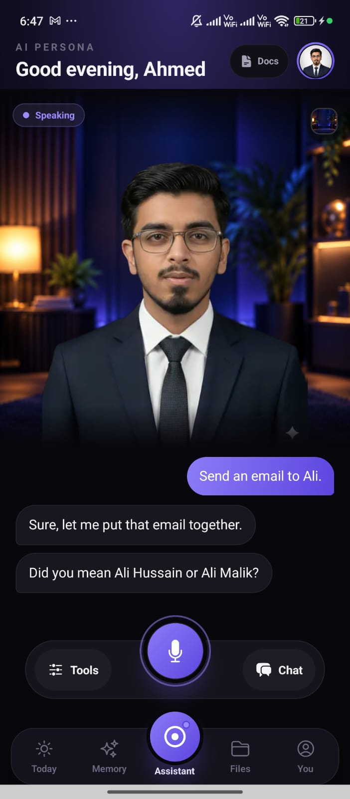 <b>It asks, it never guesses.</b> Two contacts are called Ali, so the avatar asks which one.</td>
<td align="center">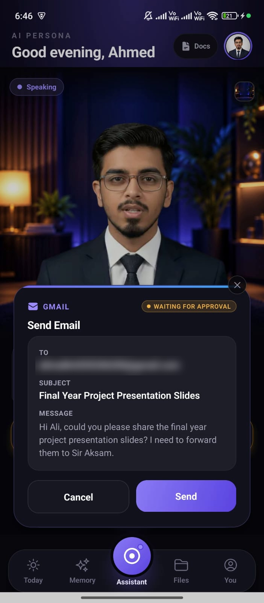 <b>Nothing is sent without a yes.</b> The finished email waits on a card while the avatar reads it out.</td>
<td align="center">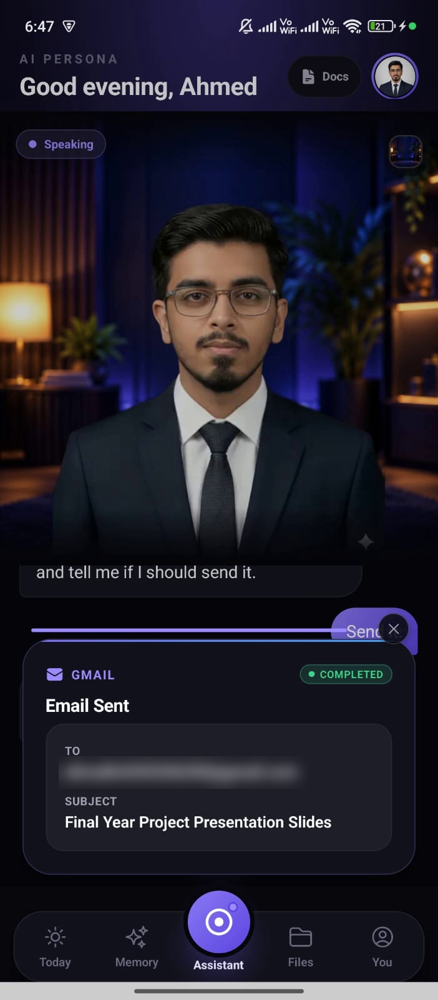 <b>Done, and said so.</b> After the yes, the card shows the email as sent.</td>
</tr>
<tr>
<td align="center">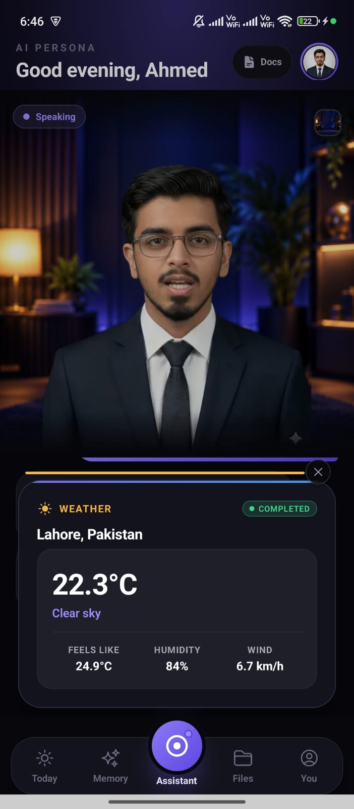 <b>Answers with a card.</b> The avatar speaks the weather and the card shows the figures.</td>
<td align="center">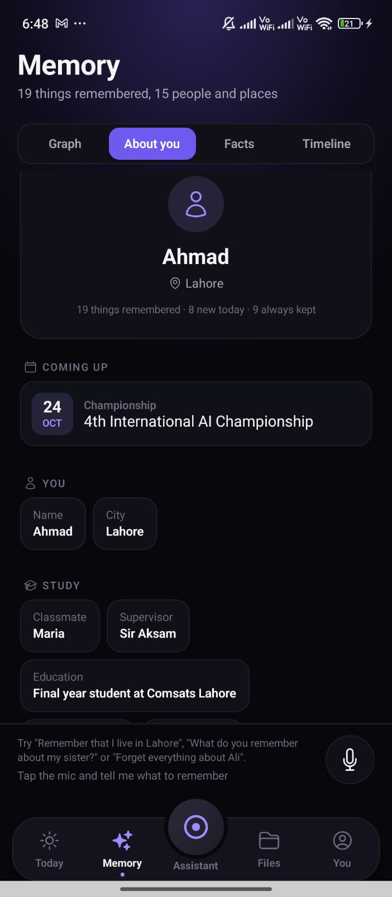 <b>What it knows about you.</b> Facts it learned in conversation, sorted into groups by itself.</td>
<td align="center">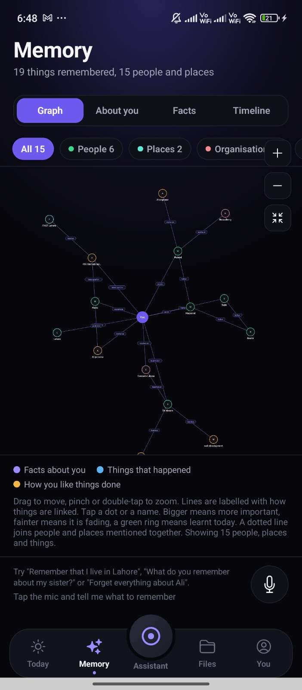 <b>The memory graph.</b> People, places and things, linked the way the user described them.</td>
</tr>
</table>

<table>
<tr>
<td align="center">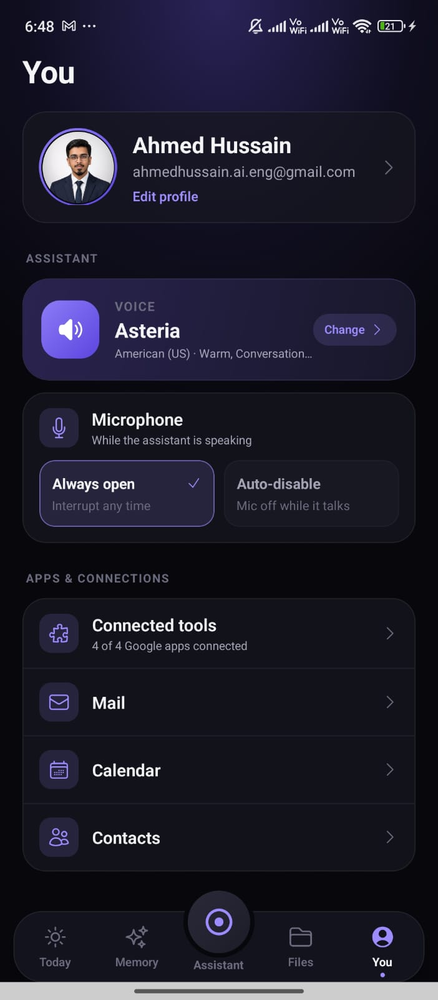 <b>The user's own assistant.</b> Their voice, microphone mode and connected Google apps.</td>
</tr>
</table>

## Demo video

A screen recording of the assistant in use: the avatar speaking, a request carried out, and the confirmation before it acts.

[Watch the demo video](demo/aipersona-web-demo.mp4)

## How it is built

| Part | Built with |
|---|---|
| Mobile app | React Native (Android) |
| Web app | React |
| Account backend | Node.js, MongoDB |
| Agent engine | Python, FastAPI |
| Avatar server | Ditto talking-head model on an NVIDIA RTX 4090 |

The source code is kept in private repositories. This repository holds the proposal and the supporting material.
